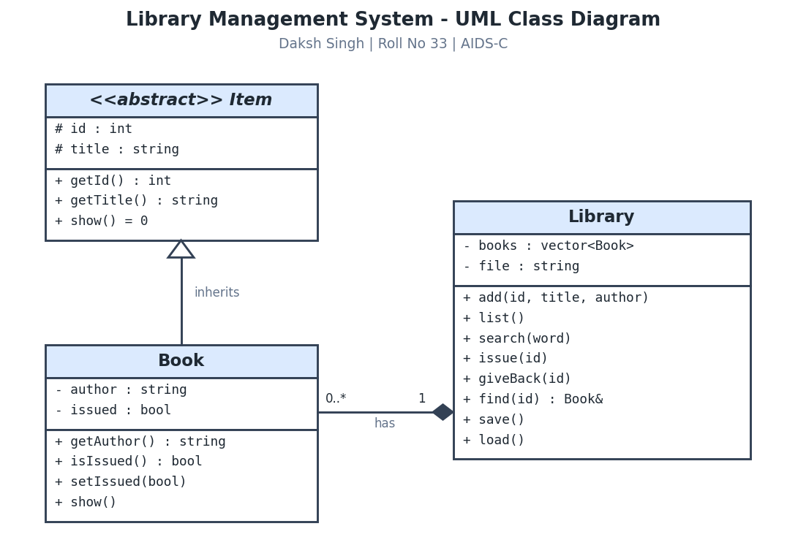

# Practical 12 - Library Management System

A small console app to manage books in a library.
Made by Daksh Singh (Roll No 33, AIDS-C) for the C++ OOP practicals.

## Features
- Add a book with id, title and author
- List all books and see if they are available or issued
- Search by title or author
- Issue a book and return it
- Saves everything to `books.csv` on exit and loads it again on the next start

It also handles mistakes without crashing:
- wrong book id
- adding an id that already exists
- issuing a book that is already issued
- returning a book that was never issued
- wrong menu choice

## How to run
```
g++ -std=c++17 library.cpp -o library
./library
```
`books.csv` in this folder has some sample books, so the list isn't empty on the first run.

## What I used
| Concept | Where |
|---|---|
| Classes and encapsulation | `Book` keeps `author` and `issued` private, so they change only through its functions |
| Inheritance | `Book` inherits from `Item` |
| Polymorphism | `show()` is a pure virtual function in `Item`, so `Item` is abstract |
| STL | `vector<Book>` holds all the books |
| Exceptions | `throw string(...)` for errors, caught in `main()` |
| File handling | `ofstream` / `ifstream` to save and load the CSV |

## UML class diagram


## Sample run
```
1.Add 2.List 3.Search 4.Issue 5.Return 0.Save & Exit
Choice: 3
Enter title or author: Kanetkar
102 | Let Us C | Yashavant Kanetkar | Available

Choice: 4
Book id: 102
Issued: Let Us C

Choice: 4
Book id: 102
Error: Book is already issued
```
